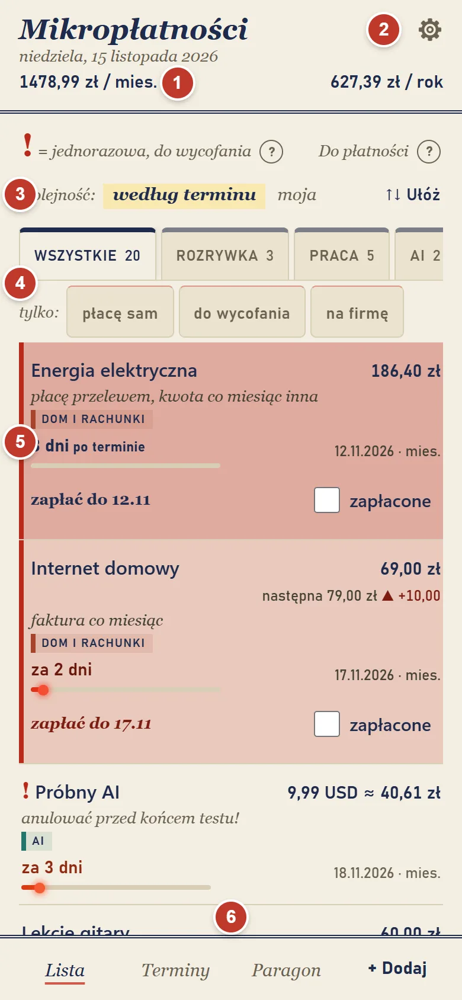
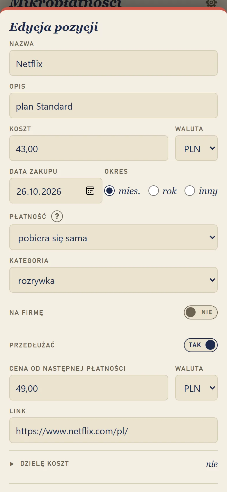

# Mikropłatności

[](https://github.com/Bakeron/mikroplatnosci/actions/workflows/testy.yml)

Aplikacja do pilnowania subskrypcji i drobnych płatności: pokazuje, ile naprawdę kosztują miesięcznie (w złotówkach, po kursie NBP), kiedy wypada następne odnowienie i których usług nie przedłużać. Wersja na Windows i na Androida, na tych samych danych. Bez konta i bez własnego serwera.

**[Wypróbuj w przeglądarce](https://mikro.szymonbakonis.pl)** (wersja demonstracyjna z wymyślonymi danymi, komputer i telefon) · **[Instrukcja ze zrzutami](https://mikro.szymonbakonis.pl/instrukcja/)**


<p>
  
  
</p>

Telefon - lista i edycja pozycji (zrzuty z [instrukcji](https://mikro.szymonbakonis.pl/instrukcja/), tam opis numerów).

> **In English:** a personal subscription tracker for Windows (Neutralinojs, ~2.5 MB) and Android (Capacitor) sharing one data format and one set of calculation modules. Data stays on the device; optional sync goes through a single file in the user's Google Drive (`drive.file` - the app sees only files it created; OAuth device flow). Built with Claude Code as a pair programmer: the author set the requirements and made the decisions, Claude wrote the code, tests and audits. Code and docs are in Polish.

## Co umie

- **Lont terminu** - przy każdej pozycji pasek dopalający się do dnia odnowienia, kolor od zielonego do czerwonego.
- **Paragon** - sumy miesięczne i roczne w złotówkach, waluty obce przeliczane po kursie średnim NBP, prognoza na miesiąc.
- **Miarka 3 miesięcy** - najbliższe terminy rozłożone na osi czasu.
- **Cena od następnej płatności** - wpisujesz ją, gdy kończy się promocja albo serwis zapowiedział podwyżkę; aplikacja pokazuje, o ile będzie drożej lub taniej.
- **Płatność ręczna** - przy rachunkach, które nie schodzą same z konta (np. prąd): tydzień przed terminem czerwony margines, przypomnienie i pole „☐ zapłacone”.
- **Synchronizacja z Google Dyskiem** - zmiany z telefonu trafiają na komputer i odwrotnie, scalane wiersz po wierszu. Telefon wysyła i pobiera sam; komputer z zapisem lokalnym - przyciskami „↓ Pobierz z Dysku” / „↑ Wyślij na Dysk”, bez zapisu lokalnego - sam.
- **O aplikacji** - wersja, prywatność w skrócie, kontakt, licencje bibliotek.
- **Wspólne dane dla kilku osób** (np. dla domowników, same telefony) - każda osoba włącza synchronizację u siebie, a kod pokazany w aplikacji wpisuje na stronie Google właściciel danych, swoim kontem (można to zrobić na jego telefonie). Wszystkie urządzenia korzystają z jednego pliku na Dysku właściciela i widzą te same pozycje; zmiany są scalane jak między komputerem a telefonem. Druga osoba nie poznaje hasła właściciela, a aplikacja dostaje dostęp tylko do swojego pliku - nie do poczty, zdjęć ani innych plików. Odłączenie: „wyłącz synchronizację” w aplikacji tej osoby.
- **Gdzie trzymać dane** - na urządzeniu, na swoim Google Dysku albo w obu miejscach; przyciski „Usuń z komputera” / „Usuń z Dysku” kasują dane z jednego miejsca.
- **Powiadomienia** o pozycjach, których nie przedłużasz, zanim się odnowią.

Wygląd wynika z jednego pomysłu: **zeszyt rachunkowy** - liniatura, czerwony margines, paragon z ząbkowanym brzegiem, pieczątka „Wykreśl”. Motyw „noc” i „dzień”.

## Technologie i dlaczego

| Część | Technologia | Dlaczego |
|---|---|---|
| Windows | [Neutralinojs](https://neutralino.js.org/) 6.10, czysty HTML/CSS/JavaScript | ok. 2,5 MB zamiast ok. 150 MB Electrona, okno przez WebView2 wbudowany w Windows 11, bez kompilacji |
| Android | [Capacitor](https://capacitorjs.com/) 8 | ten sam kod obliczeń co na PC, APK ok. 5,8 MB (z kodem QR do łączenia urządzeń) |
| Dane | plik JSON na urządzeniu | zapis przez plik tymczasowy i podmianę, 5 kopii zapasowych, blokada zapisu po błędzie odczytu |
| Synchronizacja | Google Dysk, jeden plik w „Moim dysku” (zakres `drive.file`), logowanie kodem | za darmo, bez własnego serwera; aplikacja widzi tylko pliki, które sama utworzyła, nie dokumenty użytkownika |
| Testy | `node --test` (wbudowany w Node.js) | bez dodatkowych bibliotek, bez sieci i bez prawdziwych danych |

## Jak to jest zbudowane

```
                 pc/resources/js/  (wspólne obliczenia: terminy, waluty, paragon, format danych, scalanie, Dysk)
                  │                         │
          aplikacja PC                kopiowane przy budowaniu
       (Neutralino, pc/)          (mobile/skrypty/przygotuj.mjs)
                  │                         │
   plik JSON w %APPDATA%          aplikacja na Androida (Capacitor, mobile/)
                  │                         │
                  └──── Google Dysk (plik w „Moim dysku”) ───────┘
```

Telefon nie ma własnej kopii obliczeń - przy budowaniu bierze pliki z `pc/resources/js/`. Dzięki temu poprawka terminu czy kursu działa od razu w obu aplikacjach, a aplikacja PC buduje się bez zmian. Różnice platform (zapis plików, otwieranie stron) załatwia mały zamiennik `mobile/src/js/neutralino-telefon.js`.

| Folder / plik | Co to |
|---|---|
| `pc/` | aplikacja na Windows, testy (`pc/testy/`), instalacja (`pc/instalacja/instaluj.ps1`) |
| `mobile/` | aplikacja na Androida - opis budowania w [`mobile/README.md`](mobile/README.md) |
| `Podgląd/` | obrazki aplikacji z danymi przykładowymi i źródła do ich odtworzenia |

## Uruchomienie

Potrzebny [Node.js](https://nodejs.org/) (sprawdzone na 24) i Windows 10/11 z WebView2.

```
cd pc
npm install
npx neu update      # pobiera program Neutralino (bin/ nie jest w repozytorium)
npm run start       # okno aplikacji
npm test            # testy, ok. 2 s
```

Instalacja na stałe ze skrótem na pulpicie: `powershell -NoProfile -ExecutionPolicy Bypass -File pc\instalacja\instaluj.ps1` (najpierw uruchamia testy). Android: [`mobile/README.md`](mobile/README.md).

## Jak powstał - praca z Claude Code

Projekt powstał w parze z [Claude Code](https://claude.com/claude-code) (AI). Podział ról:

- **Autor:** wymagania, wszystkie decyzje produktowe i architektoniczne, testy na prawdziwym sprzęcie i koncie Google, akceptacja każdej zmiany. Przykłady decyzji: Google Dysk zamiast własnego serwera i Firebase (porównanie 5 wariantów), bez dodatkowego szyfrowania hasłem, APK bez sklepu, bez sortowania tabeli (własna kolejność), nowa pozycja domyślnie „przedłużać: tak”.
- **Claude:** kod, testy, skrypty budowania, dokumentacja, propozycje rozwiązań z kosztami. Drobne decyzje techniczne podejmuje sam i zapisuje je w raportach.

Zasady pracy (wspólne dla projektów autora): minimalne zmiany, prawdziwych danych użytkownika AI nigdy nie dotyka, sekrety tylko w zmiennych środowiskowych, każda zmiana sprawdzana testami, a wygląd - zrzutem ekranu.

**Audyty.** Kod regularnie sprawdzają audyty Claude Code uruchamiane jak polecenia (to narzędzia pracy, nie część aplikacji, więc nie ma ich w repozytorium). 4 są napisane pod ten projekt: `/code-review` (poprawność), `/simplify` (uproszczenia), `/better` (wydajność), `/bezpieczenstwo` (uprawnienia Neutralino, CSP, dane). 4 są wspólne dla projektów autora: interfejs (czytelność, dostępność, wygląd), teksty, sprawy techniczne (zależności, testy, bezpieczeństwo zmian, spójność) i publikacja. Poprawki, które nie wymagają decyzji, trafiają do kodu od razu, z testami i zrzutem ekranu. Sprawy do decyzji (zmiana założeń, koszt, prywatność) czekają na autora.

**Testy:** `pc/testy/` - format danych, scalanie, przebieg synchronizacji, Google Dysk na udawanym serwerze, terminy i powiadomienia ze stałą datą, kursy NBP, ochrona przed złośliwymi linkami, kompletność plików telefonu.

## Stan projektu (15.11.2026)

- Aplikacja na Windows: działa, używana na co dzień.
- Aplikacja na Androida: działa na telefonie autora (instalka APK spoza sklepu); te same dane co na komputerze.
- Synchronizacja z Google Dyskiem: działa na prawdziwym koncie Google. Projekt Google Cloud jest w trybie testowym - dla innych osób trzeba go jeszcze przełączyć na „W produkcji”.
- Wersja demonstracyjna w przeglądarce (komputer i telefon), instrukcja ze zrzutami i polityka prywatności - opublikowane.
- Google Play - w przygotowaniu (konto osobiste wymaga najpierw testu zamkniętego: 12 testerów przez 14 dni).

## Licencja

MIT (plik `LICENSE`) - kod można dowolnie używać, zmieniać i rozpowszechniać, zachowując informację o autorze. Użyte biblioteki i czcionki mają własne licencje (MIT, Apache 2.0, SIL OFL) - lista w oknie „O aplikacji”, pełna licencja Neutralinojs w `pc/instalacja/LICENSE-Neutralinojs.txt`.
