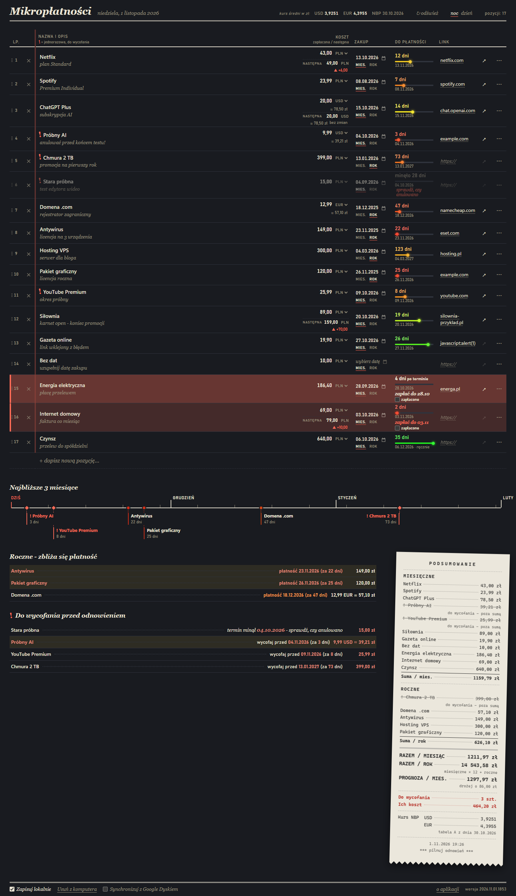

# Mikropłatności

[](https://github.com/Bakeron/mikroplatnosci/actions/workflows/testy.yml)

*[English summary below](#in-english)*

Pilnuje subskrypcji i drobnych płatności. Pokazuje, ile naprawdę kosztują miesięcznie (po kursie NBP) i kiedy wypada odnowienie. Działa na Windowsie i Androidzie na tych samych danych.

**[Wypróbuj w przeglądarce](https://mikro.szymonbakonis.pl)** (wersja demonstracyjna z wymyślonymi danymi, komputer i telefon) · **[Instrukcja ze zrzutami](https://mikro.szymonbakonis.pl/instrukcja/)**



<p>
  
  
</p>

Lista i edycja pozycji na telefonie. Zrzuty pochodzą z [instrukcji](https://mikro.szymonbakonis.pl/instrukcja/), która opisuje ponumerowane znaczniki.

## Co umie

- **Lont terminu** - przy każdej pozycji pasek dopala się do dnia odnowienia. Kolor przechodzi od zielonego do czerwonego.
- **Paragon** - sumy miesięczne i roczne w złotówkach oraz prognoza na miesiąc. Waluty obce są przeliczane po kursie średnim NBP.
- **Miarka 3 miesięcy** - najbliższe terminy rozłożone na osi czasu.
- **Cena od następnej płatności** - przydaje się, gdy kończy się promocja albo serwis zapowiedział podwyżkę. Aplikacja pokazuje, o ile będzie drożej lub taniej.
- **Płatność ręczna** - dla rachunków, które nie schodzą same z konta (np. prąd). Tydzień przed terminem pojawia się czerwony margines i przypomnienie. Zapłatę zaznacza się polem „☐ zapłacone”, także przed terminem.
- **Synchronizacja z Google Dyskiem** - zmiany z telefonu trafiają na komputer i odwrotnie. Są scalane wiersz po wierszu. Telefon wysyła i pobiera dane sam, a komputer z zapisem lokalnym robi to przyciskami „↓ Pobierz z Dysku” i „↑ Wyślij na Dysk”.
- **Wspólne dane dla kilku osób** (np. domowników z telefonami) - wszystkie urządzenia korzystają z jednego pliku na Dysku właściciela danych i widzą te same pozycje. Właściciel potwierdza dostęp swoim kontem Google, wpisując na stronie Google kod pokazany w aplikacji. Druga osoba nie poznaje jego hasła, a aplikacja nie widzi poczty, zdjęć ani innych plików.
- **Gdzie trzymać dane** - na urządzeniu, na Google Dysku albo w obu miejscach. Przyciski „Usuń z komputera” i „Usuń z Dysku” kasują dane z jednego miejsca. Nie trzeba zakładać konta.
- **Powiadomienia** - przypominają o pozycjach oznaczonych „Przedłużać: nie”, zanim się odnowią.
- **O aplikacji** - wersja, prywatność w skrócie, kontakt i licencje bibliotek.

Wygląd wynika z jednego pomysłu, czyli **zeszytu rachunkowego**. Stąd liniatura, czerwony margines, paragon z ząbkowanym brzegiem i pieczątka „Wykreśl”. Są dwa motywy, „noc” i „dzień”.

## Technologie i dlaczego

| Część | Technologia | Dlaczego |
|---|---|---|
| Windows | [Neutralinojs](https://neutralino.js.org/) 6.10, czysty HTML/CSS/JavaScript | ok. 2,5 MB zamiast ok. 150 MB Electrona, okno przez WebView2 wbudowany w Windows 11, bez kompilacji |
| Android | [Capacitor](https://capacitorjs.com/) 8 | ten sam kod obliczeń co na PC, APK ok. 5,8 MB (z kodem QR do łączenia urządzeń) |
| Dane | plik JSON na urządzeniu | zapis przez plik tymczasowy i podmianę, 5 kopii zapasowych, blokada zapisu po błędzie odczytu |
| Synchronizacja | Google Dysk, jeden plik w „Moim dysku” (zakres `drive.file`), logowanie kodem | za darmo, bez własnego serwera, aplikacja widzi tylko pliki, które sama utworzyła |
| Testy | `node --test` (wbudowany w Node.js), GitHub Actions | bez dodatkowych bibliotek, bez sieci i bez prawdziwych danych |

## Jak to jest zbudowane

```
                 pc/resources/js/  (wspólne obliczenia: terminy, waluty, paragon, format danych, scalanie, Dysk)
                  │                         │
          aplikacja PC                kopiowane przy budowaniu
       (Neutralino, pc/)          (mobile/skrypty/przygotuj.mjs)
                  │                         │
   plik JSON w %APPDATA%          aplikacja na Androida (Capacitor, mobile/)
                  │                         │
                  └──── Google Dysk (plik w „Moim dysku”) ───────┘
```

Telefon nie ma własnej kopii obliczeń. Przy budowaniu bierze pliki z `pc/resources/js/`. Dzięki temu poprawka terminu czy kursu działa od razu w obu aplikacjach, a aplikacja PC buduje się bez zmian. Różnice platform (zapis plików, otwieranie stron) załatwia mały zamiennik `mobile/src/js/neutralino-telefon.js`.

| Folder / plik | Co to |
|---|---|
| `pc/` | aplikacja na Windows, testy (`pc/testy/`), instalacja (`pc/instalacja/instaluj.ps1`) |
| `mobile/` | aplikacja na Androida, opis budowania w [`mobile/README.md`](mobile/README.md) |
| `Podgląd/` | obrazki aplikacji z danymi przykładowymi i źródła do ich odtworzenia |

## Uruchomienie

Potrzebne są [Node.js](https://nodejs.org/) (sprawdzone na wersji 24) oraz Windows 10 lub 11 z WebView2.

```
cd pc
npm install
npx neu update      # pobiera program Neutralino (bin/ nie jest w repozytorium)
npm run start       # okno aplikacji
npm test            # testy, ok. 2 s
```

Instalację na stałe ze skrótem na pulpicie robi polecenie `powershell -NoProfile -ExecutionPolicy Bypass -File pc\instalacja\instaluj.ps1`, które najpierw uruchamia testy. Budowanie wersji na Androida opisuje [`mobile/README.md`](mobile/README.md).

## Jak powstał

Cały kod napisał [Claude Code](https://claude.com/claude-code), a ja ustalałem założenia, podejmowałem decyzje, pilnowałem testów oraz audytów i sprawdzałem każdą zmianę. Aplikację testowałem na własnym komputerze, telefonie i koncie Google.

Wszystkie decyzje produktowe i architektoniczne były moje. Wybrałem na przykład Google Dysk zamiast własnego serwera i Firebase, po porównaniu 5 wariantów. Zrezygnowałem z dodatkowego szyfrowania hasłem i z sortowania tabeli, bo kolejność ustala użytkownik. Claude oprócz kodu pisał testy, skrypty budowania i dokumentację oraz proponował rozwiązania razem z kosztem. Drobne decyzje techniczne podejmował sam i zapisywał je w raportach.

W pracy obowiązywały wspólne zasady moich projektów. Zmiany są minimalne, a AI nigdy nie dotyka prawdziwych danych użytkownika. Sekrety są tylko w zmiennych środowiskowych. Każdą zmianę sprawdzają testy, a zmianę wyglądu dodatkowo zrzut ekranu.

Kod regularnie sprawdzają audyty Claude Code uruchamiane jak polecenia. To narzędzia pracy, a nie część aplikacji, więc nie ma ich w repozytorium. Cztery powstały dla tego projektu. Są to `/code-review` (poprawność), `/simplify` (uproszczenia), `/better` (wydajność) i `/bezpieczenstwo` (uprawnienia Neutralino, CSP, dane). Cztery kolejne są wspólne dla moich projektów i sprawdzają interfejs, teksty, sprawy techniczne oraz gotowość do publikacji. Poprawki, które nie wymagają decyzji, trafiają do kodu od razu, z testami i zrzutem ekranu. Sprawy do decyzji (zmiana założeń, koszt, prywatność) czekają na mnie.

Testy w `pc/testy/` sprawdzają format danych, scalanie i przebieg synchronizacji. Google Dysk jest testowany na udawanym serwerze, a terminy i powiadomienia ze stałą datą. Testy obejmują też kursy NBP, ochronę przed złośliwymi linkami i kompletność plików telefonu. Uruchamiają się w GitHub Actions przy każdym pushu.

## Stan projektu (19.11.2026)

- Aplikacja na Windows działa i jest używana na co dzień.
- Aplikacja na Androida działa na moim telefonie jako instalka APK spoza sklepu. Korzysta z tych samych danych co komputer.
- Synchronizacja z Google Dyskiem działa na prawdziwym koncie Google. Projekt Google Cloud jest jeszcze w trybie testowym. Przed udostępnieniem innym osobom trzeba go przełączyć na „W produkcji”.
- Wersja demonstracyjna w przeglądarce (komputer i telefon), instrukcja ze zrzutami i polityka prywatności są opublikowane.
- Wydanie w Google Play jest w przygotowaniu. Konto osobiste wymaga najpierw testu zamkniętego z 12 testerami przez 14 dni.

## Licencja

Projekt jest udostępniony na licencji MIT (plik `LICENSE`). Kod można dowolnie używać, zmieniać i rozpowszechniać, zachowując informację o autorze. Użyte biblioteki i czcionki mają własne licencje (MIT, Apache 2.0, SIL OFL). Ich lista jest w oknie „O aplikacji”, a pełna licencja Neutralinojs w `pc/instalacja/LICENSE-Neutralinojs.txt`.

---

## In English

Mikropłatności ("micropayments") is a tracker for subscriptions and small payments on Windows and Android. It shows what they really cost per month (converted at the Polish central bank rate) and when each one renews.

- A "fuse" bar next to each item burns down to the renewal date.
- A receipt with monthly and yearly totals in PLN.
- Reminders for manually paid bills and for subscriptions to cancel.
- Optional sync between devices through one file in the user's Google Drive, merged row by row, with no own server.

Built with Neutralinojs (Windows), Capacitor (Android), plain JavaScript and the Node.js test runner.

All code was written by Claude Code. I set the requirements, made the decisions, oversaw tests and audits, and reviewed every change.

[Try the demo in the browser](https://mikro.szymonbakonis.pl). The full description above is in Polish.
